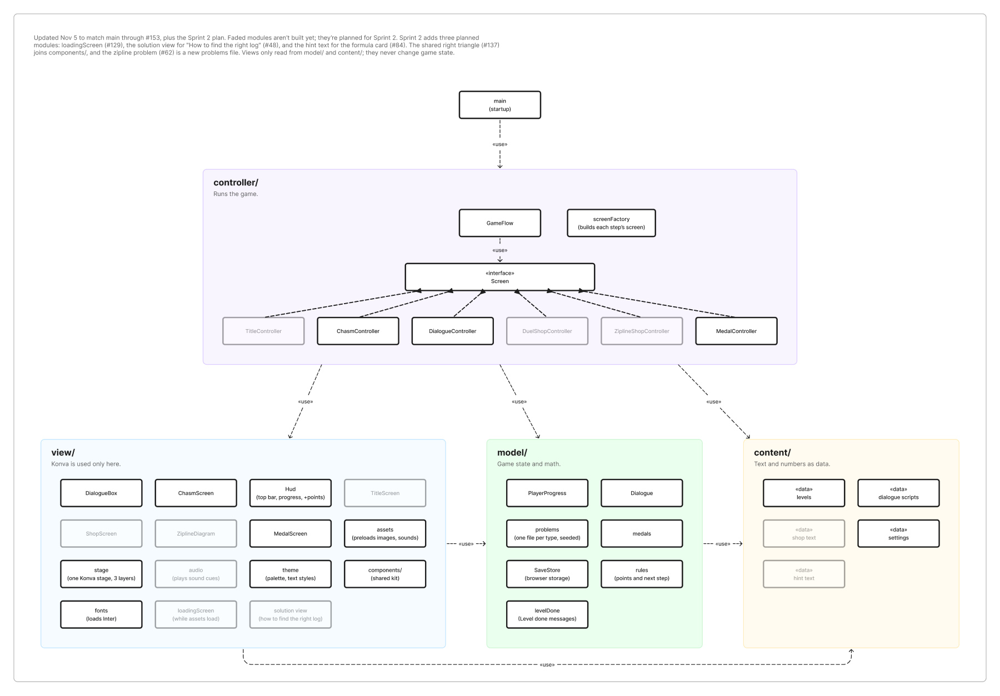

# The Math Mountaineer

We present a fun and educational game for all those 8th graders out there! Students climb a mountain to find a missing friend, crossing each chasm by picking the log that fits, which is the hypotenuse of a right triangle. Built in TypeScript, with [Konva](https://konvajs.org/) drawing on a canvas, [Vite](https://vite.dev/) running and building the game, and [Vitest](https://vitest.dev/) for tests.

**Play it at [ilovelogic.github.io/the-math-mountaineer-team-7](https://ilovelogic.github.io/the-math-mountaineer-team-7/)**, which updates every time a pull request is merged into `main`.

---

## Table of Contents

- [Where the Project Stands](#where-the-project-stands)
- [Getting Started](#getting-started)
- [Features So Far](#features-so-far)
- [Architecture Overview](#architecture-overview)
- [Project Structure](#project-structure)
- [Design Docs](#design-docs)
- [Pull Request Details](#pull-request-details-𖠿)

---

## Where the Project Stands

*Up-to-date as of November 2, 2026*

We built and tested every piece of the core game, including the chasm problems and screen, the points and medals, the player's progress and its saving, the Hud, the dialogue, and GameFlow, which plays the game's steps in order with a controller for each screen. The game now plays from start to finish: `npm run dev` opens on a placeholder title and runs through the intro, every chasm and Level done message, to the medal. What we are working on next is publishing it online (#9) and, in Sprint 2, the screens that teach the player after a wrong pick.

What this means for our team:
   - **Model, view, and content code can be built and tested on its own.** (Nothing in those folders needs the game to be running.)
   - **To see a screen you're working on**, play the game with `npm run dev`. To jump straight to it, change the step `flow.run()` starts from in `main.ts` on your own branch, and leave that change out of your PR.
   - **To find something to pick up**, the [task dependencies](https://www.figma.com/design/gtavIfNmnKuW2m81SbVA6L?node-id=179-425) show what's finished, what's due before the next standup and what's due by the end of the sprint, with one page per sprint, and the [project board](https://github.com/users/ilovelogic/projects/4) has every task.

---

## Getting Started

**Requirements**\
Node.js 24 (the version in `.nvmrc`) and npm, which comes with it. If you use nvm, `nvm use` in the project folder switches to the right version.

**Installation**
```bash
npm install
```
Run this again whenever `package.json` changes on `main`. If tests fail with "Cannot find package 'canvas'", this is the fix.

**Run the Game**
```bash
npm run dev
```
Vite prints a local address (usually http://localhost:5173). Open it in a browser, and the page reloads each time you save a file.

**Test the Project**
```bash
npm test
```
```bash
npm run typecheck
```
These are the same two checks CI runs on every pull request, so if both pass on your machine, CI should pass too. `npm run test:watch` reruns the tests each time you save.

**Build**\
`npm run build` type-checks the code and writes the finished game to `dist/`, and `npm run preview` serves that build locally.

---

## Features So Far

These are grouped by what they're for. Each links to its section in the folder docs, which share greater detail.

1. **The canvas and the look of the game**:
   - [stage](src/view/README.md#stage): The game draws in a fixed 960 × 540 space, and the stage scales it to the largest 16:9 box that fits the browser window, with tests across many window sizes.
   - [theme](src/view/README.md#theme): Every color from the Figma mockups, and the text styles we use so far, kept in one place in the code.
   - [fonts and assets](src/view/README.md#fonts-and-assets): The Inter font and the game's images ship with the game and load once, before anything is drawn. Sounds will load the same way once they're added. A file that fails is swapped for a placeholder instead of stopping the game.
   - [Shared components](src/view/README.md#shared-components): The button, log button, top bar and dialog box from the mockups, for every screen to reuse.

2. **Crossing a chasm**:
   - [problems](src/model/README.md#problems): Generates the details of each chasm. Each chasm is a whole-number right triangle (like 5-12-13) with three logs, one of which fits. Chasms come from the game's seed, so a saved game rebuilds the same ones.
   - [ChasmScreen](src/view/README.md#chasmscreen): Draws the cliffs, the triangle with its side lengths, the log pile, and a clickable button for each log.
   - [rules](src/model/README.md#rules): Ensures only the log that fits earns the corresponding 10 points.

3. **Story and progress**:
   - [dialogueScripts](src/content/README.md#dialoguescripts): The intro, the "how crossing works" scene, and the two Level done messages.
   - [Dialogue](src/model/README.md#dialogue): Tracks which dialogue box is showing, one box per click, and ignores fast double clicks.
   - [DialogueBox](src/view/README.md#dialoguebox): Shows each dialogue line in the shared dialog box, with a Continue button or the line's own choices.
   - [levels](src/content/README.md#levels): The game's steps in order after the title screen: the intro, 15 chasms over 3 levels, a Level done step after Levels 1 and 2, and the medal.
   - [PlayerProgress](src/model/README.md#playerprogress): The player's level, step, points, topic and every answer, in a form that can be saved.
   - [SaveStore](src/model/README.md#savestore): Saves one checkpoint in the browser's storage and loads it back, refusing anything that isn't a valid save.
   - [Hud](src/view/README.md#hud): The top bar with topic, level and points, a "Level 1 of 3 · Chasm 2 of 5" line, and a "+10 points" tag after a correct pick.

4. **The end of a level, and of the game**:
   - [levelDone](src/model/README.md#leveldone): Picks the Level done message from the points earned on that level, either congratulations or an offer to restart it, and fills in the level number.
   - [medals](src/model/README.md#medals): Turns the final points into a diamond, gold, silver or bronze medal (or none), using the limits in settings.
   - [MedalScreen](src/view/README.md#medalscreen): Draws the medal the player earned, the medal requirements, and a See Results button.

5. **Running the game**:
   - [GameFlow](src/controller/README.md#gameflow): Plays every step in order, one screen at a time, and decides what happens after each one, including scoring a pick, restarting a level, and saving a checkpoint.
   - [The screen controllers](src/controller/README.md#the-screen-controllers): ChasmController, DialogueController and MedalController each run one kind of screen for GameFlow.
   - [The screen factory](src/controller/README.md#the-screen-factory): Builds the right screen for each step GameFlow plays.
   - [Starting the game](src/controller/README.md#starting-the-game): Shows the title screen and starts a new game or the saved one.

**Next up**: publishing the game to GitHub Pages (#9), and, in Sprint 2, the title screen with New game and Continue (#70), the sounds (#25), the screens after a wrong pick (#47, #48 and #49), and the shops.

---

## Architecture Overview

\
*The module view showing which modules exist and what each one may use. Faded boxes aren't built yet. View the live version in [Figma](https://www.figma.com/board/UqaCm5s3LuddFWG7xfzhlS).*

We follow MVC, with a fourth folder for data. Each of these is a folder in `src/` and offers its own README:

1. **[model/](src/model/README.md)**: Stores and offers game state and math in plain TypeScript, with no drawing, allowing it to be tested without a browser. Herein live problems, rules, medals, the dialogue position, the player's progress, and saving.
2. **[view/](src/view/README.md)**: Handles everything drawn with Konva. A view may read the model to know what to draw and reports clicks through callbacks it's given, but it never decides what a click means or changes game state.
3. **[controller/](src/controller/README.md)**: Decides what happens next. GameFlow plays the game's steps one screen at a time, and every screen follows the same `Screen` contract. For each one, GameFlow starts it, and it reports back once, via `onDone`, with what the player chose.
4. **[content/](src/content/README.md)**: Has the game's text and numbers as data, so changing the story or a point value never requires editing the game code itself.

`main.ts` brings it all together. It waits for the images and fonts, creates the stage, the Hud, and the player's progress, and then starts GameFlow, which gets each step's screen from the screen factory.

**What may use what**\
The arrows in the diagram are rules we follow: `controller/` may use the other three; `view/` may read `model/` and `content/`; `model/` may read `content/`; and `content/` uses nothing. Only `main.ts` uses `controller/`. Our reviews treat breaking one of these as a must-fix.

**The central idea**\
Screens report what the player chose, and only GameFlow can decide what that choice means. GameFlow is also the only thing that changes the player's progress. Accordingly, a rule change (e.g., a new way to score) happens in one place, and a new screen only has to draw and report.

---

## Project Structure

```
src/
  main.ts          Starts it up: loads images and fonts, then starts GameFlow
  model/           Game state and math (no Konva!)
  view/            Everything drawn with Konva
    components/    The shared button, log button, top bar and dialog box
  controller/      GameFlow, the Screen contract, and one controller per kind of screen
  content/         Level steps, dialogue scripts and settings
tests/             Mirrors src/, with one test file per module
public/assets/     Images (and soon sounds), served as they are
docs/images/       Pictures used in these docs
.github/           CI, plus the pull request and issue templates
```

Most test files open with a comment saying what they check and how, which makes the tests a quick way to learn what a module is promising.

---

## Design Docs

Each link here answers one question. The images in our docs are exported from these files, so these files are the up-to-date versions.

   - [Mockups](https://www.figma.com/design/fsqgQpE8683nCpVlTI6OZd): What should each screen look like? The Resources page has the shared components, colors and text styles.
   - [Module view](https://www.figma.com/board/UqaCm5s3LuddFWG7xfzhlS) and its [supplementary board](https://www.figma.com/board/aRndxZrbIowLRfEmkPv8Fk): Which modules exist, what may each one use, and who owns it?
   - [Runtime (C&C) view](https://www.figma.com/design/LLtfHewfTMLycUXFUVuyEH): What happens, step by step, while the game runs?
   - [Task dependencies](https://www.figma.com/design/gtavIfNmnKuW2m81SbVA6L?node-id=179-425): What's finished, what's due next, and what can I start now? There's one page per sprint, and this link opens Sprint 2.
   - [Project board](https://github.com/users/ilovelogic/projects/4): Every task, with its owner, sprint and status.

In the diagrams, faded boxes and anything marked "Not built yet" are planned and not missing.

---

## Pull Request Details 𖠿

One task ⇒ one branch ⇒ one pull request (PR). Every PR is squashed into a single commit on `main`, so **the PR title is the commit message**. Commits on your own branch can say anything.

### 1. Branch Name

Name the branch after the issue: `<issue number>-<short-name>`.

```
17-dialogue-model
23-chasm-screen
```

### 2. Size and scope

- **One task per PR.** If you find a second related task/patch that needs implementing, open an issue for it instead of fixing it in the same PR.
- **Tests go in the same PR** as the code they test.
- **Aim for under about 300 changed lines.** If a task is bigger, split it into PRs that each still build and pass the tests, such as "model + tests" and then "view".
- **Only touch your own files.** Changing a file someone else owns (for example `GameFlow` or `view/components`) means asking their permission and coordinating with them first.

### 3. Title

```
type(area): what it does, see examples below for format
```

| `type` | Use it for |
|---|---|
| `feat` | something the player or the team can now do |
| `fix` | a bug fix |
| `test` | tests only |
| `refactor` | same behavior, cleaner code |
| `docs` | README, comments, docs/ |
| `chore` | setup, CI, dependencies, assets |

`area` is the folder you changed: `model`, `view`, `controller`, `content` or `ci`. Leave it out, along with the parentheses, when the change isn't in one of those folders, such as the README, `docs/` or project setup files: `docs: add pull request guidelines to the README`.

Good titles:

```
feat(model): track the current dialogue box, one box per click
feat(view): draw the chasm, side lengths and logs
fix(controller): ignore clicks after the first pick
chore(ci): run type check and tests on every pull request
```

Write it as a command that finishes the sentence "This PR will…". Keep it under about 70 characters, and leave off the final period.

### 4. Description 𓂃✍︎

Fill in this template. It appears automatically when you open a PR (it lives in `.github/pull_request_template.md`), so keep the two in sync if you change it:

```markdown
Closes #‹insert your task’s issue number here›

## What
One or two sentences: what changes.

## Why
The reason, or the user story it serves.

## How it works
A few sentences on your approach: how the code is organized and why you chose it.

## How to use it
A short example of calling your code, or the steps to see it in the game.

## How to check
- [ ] `npm test` passes
- What the tests cover, plus a screenshot or GIF for anything on screen

## Notes (optional)
Anything a reviewer or a future teammate should know: stand-ins you used, limits, follow-up issues.
```

The first line links the PR to your task (for example, `Closes #17`). When the PR is merged, GitHub closes that issue and moves its card to Done on the board.

### 5. Before you ask for a review ✔

- Read your own diff on GitHub first, then delete stray `console.log`s and commented-out code.
- CI must be green.
- Open the PR as a **Draft** while you're still working, and mark it **Ready for review** when it's done.
- Request a review from your usual reviewer below. Any teammate can approve, though, so if they haven't gotten to it, whoever has time first can review it.

| Author | Usual reviewer |
|---|---|
| Andrew, Toby, Angel | Anne |
| Anne, Jonathan | Andrew |
| Skye | Toby |
| Pranav | Jonathan |

### 6. Reviewing

- **Review within one day**, and always before the next standup to keep us on track ✧｡٩(ˊᗜˋ )و✧*. A PR waiting for review blocks people just as unfinished code does (•́ ᴖ •̀).
- **Approve when the PR makes the code better**, even if it isn't perfect. Small fixes can be follow-up issues.
- **Start each PR comment with a label** so the author knows what matters:
  - `Must fix:` blocks approval: a bug, a broken test, or a break from the module view.
  - `Question:` asks the author to explain something.
  - `Nit:` is a small style point the author may ignore.
- Be kind and specific. Comment on the code, not the person.

### 7. Merging 𑣲🫂⋆˚࿔

- Merge needs **1 approval and green CI**.
- The **author** clicks **Squash and merge**, checks that the commit title matches the PR title, and deletes the branch.
- If `main` moved on and your branch is out of date, use **Update branch** on the PR page, re-run the tests, and then merge.
