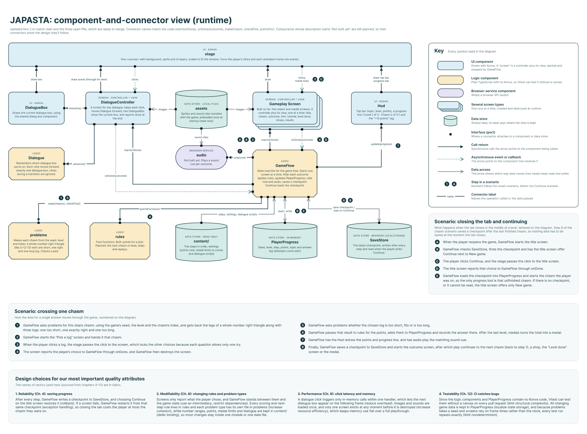

# controller/

Decides what happens next, including which screen runs, what a choice means, and when to save. `GameFlow`, the `Screen` interface, and one controller per screen type live here.

May import `model/`, `view/`, and `content/`. Nothing else imports from here except `main.ts`.

---

## Table of Contents

- [Overview](#overview)
- [Screen](#screen)
- [GameFlow](#gameflow)
- [The screen controllers](#the-screen-controllers)
- [The screen factory](#the-screen-factory)
- [Crossing one chasm, start to finish](#crossing-one-chasm-start-to-finish)

---

## Overview

This is the folder that turns our separate screens into a game. It holds the `Screen` contract, GameFlow, which plays the game's steps, a controller for each kind of screen built so far, and the screen factory, which builds the right screen for each step. `main.ts` creates GameFlow with that factory and starts it.

\
*The runtime (C&C) view, showing what talks to what while the game runs. Connector names match the code, and components marked "Not built yet" show the design. View the live version in [Figma](https://www.figma.com/design/LLtfHewfTMLycUXFUVuyEH).*

---

## Screen

**Purpose**\
Defines the one contract every screen controller follows, so that GameFlow can run any screen the same way without knowing which one it is.

**The contract**
   - **`start`**: Draws the screen and starts listening for input. GameFlow passes in a callback, `onDone`, which the screen calls exactly once when it finishes.
   - **`stop`**: Removes everything the screen drew and stops listening. A stopped screen never calls `onDone`.

**What a screen reports**\
Each screen reports an `Outcome`, which is either `done` or a `choice` holding the position of the option the player picked (in the order the screen shows them). A screen reports what the player chose, and GameFlow decides what that choice means for the game. For instance, a chasm screen reports "the second log", and GameFlow then works out that the log was too long and scores it. A screen can still check a choice to decide what to show before it reports: ChasmController checks the pick so that ChasmScreen can name the right log first.

---

## GameFlow

**Purpose**\
Runs the whole game by playing the steps in `content/levels` in order, one screen at a time, and deciding what happens after each one. It is the only thing that changes `PlayerProgress`.

**What it's given**
   - `steps`: The game's script from `content/levels`.
   - `progress`: The player's `PlayerProgress`, new or loaded from a save.
   - `makeScreen`: A function that turns a `ScreenRequest` into a `Screen`. In the game, that's the [screen factory](#the-screen-factory). A request is a step with everything its screen needs filled in, such as the chasm built from the game's seed, or the points earned on a level for its Level done message.
   - **Options** (each optional, so tests pass only what they check): the Hud to keep up to date, a `save` function such as SaveStore's, and a `playCue` function for the sound after a pick.

**After each screen**
   - **After a chasm**, GameFlow checks the pick with `model/problems`, turns it into points with `model/rules`, records the answer and adds the points to `PlayerProgress`, and then has the Hud redraw and show its "+ points" tag.
   - **After a Level done message** where the player missed points and chose to restart, it takes back that attempt's points (so they can be earned again) and goes back to the level's first chasm. Choice 0 means restart, matching the order in `model/levelDone`.
   - **After any step**, it saves a checkpoint that points at the step to play next, so a closed tab loses at most that step.

**Reports that arrive late**\
GameFlow counts each time a screen starts or stops, and ignores anything reported by a screen that's no longer current. As a result, a slow click on a screen that has already ended can never move the game forward twice.

**Testing it**\
GameFlow gets its screens through `makeScreen`. Accordingly, its tests pass in stand-in screens that report a choice right away, which lets us test the whole game's flow without drawing anything. `newSeed` takes its random numbers as a parameter for the same reason, so a test can start a game with a fixed seed.

---

## The screen controllers

Each one pairs a view from `view/` with the `Screen` contract:
   - **ChasmController**: Shows one chasm and takes only the first pick. A log that fits is reported right away. For a wrong log, ChasmScreen first says what happened and names the log that fits, and the pick is reported once the player clicks Continue. It works with any `ChasmView` (anything with `draw`, `onLogClicked`, `onChoiceSelected`, `showFeedback`, `lock` and `destroy`), so its tests use a fake view instead of `ChasmScreen`.
   - **DialogueController**: Plays one dialogue scene, from `content/dialogueScripts` or `model/levelDone`, one box per click, and reports when it ends, including which button was picked on a box with choices. The click time comes from a clock it's given, so tests can use a fake one, and the transition length comes from `settings`.
   - **MedalController**: Works out the medal from the player's points with `model/medals`, has `MedalScreen` draw it, and reports `done` once when the player presses See Results. It reads the points when it starts, so it can be created before the last chasm is scored.

**Still to come**: TitleController (#70), the controller for the "How to find the right log" screen (#48), and DuelShopController and ZiplineShopController for the two shop mini-games, planned for Sprint 2.

---

## The screen factory

**Purpose**\
Builds the screen for each step GameFlow plays, so GameFlow never needs to know which controller or view a step uses.

**How it's used**\
`main.ts` calls **`createScreenFactory`** once, with the stage's layers and the player's progress, and it returns the `makeScreen` function GameFlow is given. Each request then becomes its screen:
   - **A chasm**: A `ChasmController` around a new `ChasmScreen` for that chasm.
   - **A dialogue step**: A `DialogueController` playing the scene it names from `content/dialogueScripts`.
   - **A Level done step**: A `DialogueController` playing `levelDoneLines(...)`, filled in with the level's points.
   - **The medal**: A `MedalController`.

**The title step**\
Until the title screen (#70) exists, the title step plays `titlePlaceholder`, a one-box scene with the game's title and a Start button. Accordingly, #70 only has to replace this one case.

**When something's wrong**\
A dialogue step naming a scene that doesn't exist (e.g., a typo in `content/levels`) throws an error naming that scene, instead of handing `undefined` to the screen. A `never` check after the `switch` also means a new kind of step added to GameFlow without a case here stops the build, so the forgotten case is caught before it merges.

---

## Crossing one chasm, start to finish

A single answer moves through the game as follows:
   1. GameFlow asks `problems` for this step's chasm, using the game's seed, the level, and the chasm's position.
   2. GameFlow starts ChasmController with that chasm, and ChasmController has ChasmScreen draw it.
   3. The player clicks a log. ChasmController takes that first pick (since each chasm allows only one) and checks it with `problems`. If the log fits, it locks the logs on ChasmScreen and reports the log's position to GameFlow via `onDone`. If not, ChasmScreen says why and names the log that fits, and ChasmController reports the picked log's position once the player clicks Continue.
   4. GameFlow asks `problems` whether that log fits, is too short, or is too long.
   5. GameFlow gets the points from `rules`, adds them to `PlayerProgress`, and records the answer.
   6. GameFlow has the Hud redraw and plays the matching sound (once the sounds are added).
   7. GameFlow saves a checkpoint and moves on to the next step.
