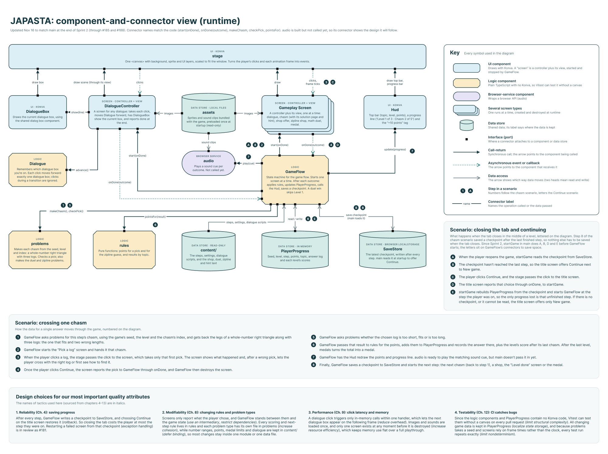

# controller/

Decides what happens next, including which screen runs, what a choice means, and when to save. `GameFlow`, the `Screen` interface, and one controller per screen type live here.

May import `model/`, `view/`, and `content/`. Nothing else imports from here except `main.ts`.

---

## Table of Contents

- [Overview](#overview)
- [Screen](#screen)
- [GameFlow](#gameflow)
- [The screen controllers](#the-screen-controllers)
- [The screen factory](#the-screen-factory)
- [Loading](#loading)
- [Starting the game](#starting-the-game)
- [Crossing one chasm, start to finish](#crossing-one-chasm-start-to-finish)
- [The hint](#the-hint)

---

## Overview

This is the folder that turns our separate screens into a game. It holds the `Screen` contract, GameFlow, which plays the game's steps, a controller for each kind of screen built so far, and the screen factory, which builds the right screen for each step. `main.ts` shows the title screen first, then creates GameFlow with that factory for the game the player picked.

\
*The runtime (C&C) view, showing what talks to what while the game runs. Connector names match the code. `audio` is built but not called yet, so its connector shows the design it will follow. View the live version in [Figma](https://www.figma.com/design/LLtfHewfTMLycUXFUVuyEH).*

---

## Screen

**Purpose**\
Defines the one contract every screen controller follows, so that GameFlow can run any screen the same way without knowing which one it is.

**The contract**
   - **`start`**: Draws the screen and starts listening for input. GameFlow passes in a callback, `onDone`, which the screen calls exactly once when it finishes.
   - **`stop`**: Removes everything the screen drew and stops listening. A stopped screen never calls `onDone`.

**What a screen reports**\
Each screen reports an `Outcome`, which is either `done` or a `choice` holding the position of the option the player picked (in the order the screen shows them). A screen reports what the player chose, and GameFlow decides what that choice means for the game. For instance, a chasm screen reports "the second log", and GameFlow then works out that the log was too long and scores it. A screen can still check a choice to decide what to show before it reports: ChasmController checks the pick so that ChasmScreen can name the right log first.

---

## GameFlow

**Purpose**\
Runs the whole game by playing the steps in `content/levels` in order, one screen at a time, and deciding what happens after each one. It is the only thing that changes `PlayerProgress`.

**What it's given**
   - `steps`: The game's script from `content/levels`.
   - `progress`: The player's `PlayerProgress`, new or loaded from a save.
   - `makeScreen`: A function that turns a `ScreenRequest` into a `Screen`. In the game, that's the [screen factory](#the-screen-factory). A request is a step with everything its screen needs filled in, such as the chasm or duel question built from the game's seed, or the points earned on a level for its Level done message.
   - **Options** (each optional, so tests pass only what they check): the Hud to keep up to date, a `save` function such as SaveStore's, and a `playCue` function for the sound after a pick.

**After each screen**
   - **After a chasm**, GameFlow checks the pick with `model/problems`, turns it into points with `model/rules`, records the answer and adds the points to `PlayerProgress`, and then has the Hud redraw and show its "+ points" tag. After the last chasm of a level, it also records that attempt's score for the level in `PlayerProgress`'s `levelAttempts` (#87), so a restarted level adds a second score instead of replacing the first.
   - **After the zipline shop**, it checks the player's guess with `model/zipline` and adds `ziplinePoints` from `model/rules`, 50 for the right answer and nothing for a wrong one. Leaving before guessing reports no choice, so it earns nothing.
   - **After a Level done message** where the player missed points and chose to restart, it takes back that attempt's points (so they can be earned again) and goes back to the level's first chasm. Choice 0 means restart, matching the order in `model/levelDone`.
   - **After a shop offer**, it plays the shop's mini-game next if the player accepted, and skips it if they declined, so declining earns no points. When GameFlow is created, it checks that every offer comes right before its own shop's mini-game, so a reordered script fails before anything plays instead of skipping the wrong step.
   - **After the math duel**, it reads how the duel ended from `DUEL_RESULT`. A win where the player climbs (`skipLevel`) gives the points from `model/rules`' `skippedLevelPoints` (`pointsPerSkippedLevel` in settings, 30 today, #58), shows the "+ points" tag, and jumps to the step after the next Level done, which is the start of Level 2. Turning down the gear (`normalPath`) or not winning (`notWon`) goes on to the next step. When GameFlow is created, it checks that a Level done comes after the duel, so a win always has somewhere to go.
   - **After any step**, it saves a checkpoint that points at the step to play next, so a closed tab loses at most that step.

**Reports that arrive late**\
GameFlow counts each time a screen starts or stops, and ignores anything reported by a screen that's no longer current. As a result, a slow click on a screen that has already ended can never move the game forward twice.

**Testing it**\
GameFlow gets its screens through `makeScreen`. Accordingly, its tests pass in stand-in screens that report a choice right away, which lets us test the whole game's flow without drawing anything. `newSeed` takes its random numbers as a parameter for the same reason, so a test can start a game with a fixed seed.

---

## The screen controllers

Each one pairs a view from `view/` with the `Screen` contract:
   - **ChasmController**: Shows one chasm and takes only the first pick, which it checks with `model/problems` so that ChasmScreen can show what happened before anything is reported:
      - **A log that fits**: ChasmScreen says so, and the pick is reported once the player clicks Continue.
      - **A wrong log**: ChasmScreen says what happened and names the log that fits. "Cross the chasm using the correct log" shows the crossing, and the pick is reported on the Continue after it. "First, see how to derive the correct answer" shows the solution page (`ChasmSolutionScreen`) first, whose own button goes back to the crossing.

     Either way, GameFlow scores the pick that was made, so crossing with the right log afterwards never earns its points. It works with any `ChasmView` and `ChasmSolutionView`, so its tests use fake views instead of `ChasmScreen` and `ChasmSolutionScreen`.
   - **DialogueController**: Plays one dialogue scene, from `content/dialogueScripts` or `model/levelDone`, one box per click, and reports when it ends, including which button was picked on a box with choices. The click time comes from a clock it's given, so tests can use a fake one, and the transition length comes from `settings`.
   - **MedalController**: Works out the medal from the player's points with `model/medals`, has `MedalScreen` draw it, and reports `done` once when the player presses See Results. It reads the points when it starts, so it can be created before the last chasm is scored.
   - **ShopOfferController**: Shows a shop's offer and reports the first button picked, `ACCEPT` or `DECLINE` from `content/shopText`. Later clicks, and clicks after `stop()`, report nothing. It works with any `ShopOfferView` (anything with `draw`, `onChoice` and `destroy`), so its tests use a fake view instead of `ShopOfferScreen`.
   - **DuelShopController**: Plays the math duel page by page, as in the Math duel mockups: the challenge, the tutorial offer and tutorial, the duel, and the won (then climb) or lost (then solution) pages, with each page's text from `content/duelText`. On the duel page, the right option wins, while a wrong one or the store owner's timer finishing first loses. It reports how the duel ended once, as a choice from `DUEL_RESULT`: `skipLevel` (won and took the shortcut), `normalPath` (won but turned down the gear) or `notWon` (left before the duel, or lost), and GameFlow decides what that means (see [GameFlow](#gameflow)). Clicks just after a page appears are ignored, using the same `dialogueTransitionMs` as dialogue, so a fast double click never presses a button on the next page. It works with any `DuelView`, `DuelQuestionChoices` and `OpponentTimer`, so its tests use stand-ins. In the game its view is `DuelScreen` and its question is `makeDuelQuestion`'s (#56), which GameFlow puts in the request. Its timer is `OwnerProgress` (#57), the store owner's progress pie, which the screen factory draws on the ui layer; if it fills before the player answers, the player loses.

   - **ZiplineShopController**: Plays the zipline challenge at the clothing shop page by page, as in the Clothing shop mockups: the store owner's deal, the problem, the tutorial, the answer, and the right or wrong pages after it, with each page's text from `content/ziplineText` and the problem's numbers filled in by `fillZiplineText`. The player gets one guess. When the shop ends, it reports the guess as a choice holding its position among the three, for GameFlow to check and score, or `done` if the player left before guessing. Clicks just after a page appears are ignored, using `dialogueTransitionMs`, so a fast double click never presses a button on the next page. It works with any `ZiplineView`, so its tests use a fake view instead of `ZiplineScreen`.
   - **TitleController**: Shows the title screen with New game, plus Continue when it's told there's a game to continue, and reports the first button picked, `NEW_GAME` or `CONTINUE`. It never reads the save itself (see [Starting the game](#starting-the-game)). It works with any `TitleView`, so its tests use a fake view instead of `TitleScreen`.

---

## The screen factory

**Purpose**\
Builds the screen for each step GameFlow plays, so GameFlow never needs to know which controller or view a step uses.

**How it's used**\
`main.ts` calls **`createScreenFactory`** once, with the stage's layers and the player's progress, and it returns the `makeScreen` function GameFlow is given. Each request then becomes its screen:
   - **A chasm**: A `ChasmController` around a new `ChasmScreen` for that chasm, and a `ChasmSolutionScreen` with its worked steps from `solutionSteps`.
   - **A dialogue step**: A `DialogueController` playing the scene it names from `content/dialogueScripts`.
   - **A Level done step**: A `DialogueController` playing `levelDoneLines(...)`, filled in with the level's points.
   - **The medal**: A `MedalController`.
   - **A shop offer**: A `ShopOfferController` around a new `ShopOfferScreen`, showing that shop's offer from `content/shopText`.
   - **A shop mini-game**: For the supply shop, a `DuelShopController` around a new `DuelScreen`, both given the duel question from the request and an `OwnerProgress` for the store owner's race. For the clothing shop, a `ZiplineShopController` around a new `ZiplineScreen` for the zipline problem from the request.

**When something's wrong**\
A dialogue step naming a scene that doesn't exist (e.g., a typo in `content/levels`) throws an error naming that scene, instead of handing `undefined` to the screen. A `never` check after the `switch` also means a new kind of step added to GameFlow without a case here stops the build, so the forgotten case is caught before it merges.

---

## Loading

**Purpose**\
Shows the loading screen only when loading is slow (#129). A load that finishes before `settings.loadingScreenDelayMs` (1000 ms) never shows it, so fast loads don't flash it for a split second.

**How it's used**\
`main.ts` creates the stage, starts `loadFonts()` without waiting, and then awaits **`showWhileSlow`** with `loadAssets`, a function that draws the loading screen, the delay, and the font's promise. `showWhileSlow` starts loading right away. If loading is still going after the delay, it draws the screen once the font is ready, so its text never starts in the fallback font, and fills the bar to the files already finished. The bar then follows each file, and the screen is removed as soon as loading ends.

**Why it's a controller**\
The view only draws, and this decides when, so it lives here, as in the rest of MVC. It takes the loading and the drawing as functions, so its tests use stand-ins and fake timers instead of real files, Konva, or waiting.

---

## Starting the game

**Purpose**\
Shows the title screen and starts the game the player picked: the saved one on Continue, or a new one on New game (#70, #71).

**How it's used**\
`main.ts` calls **`startGame`** with what `SaveStore.load()` returned, the position of the last step, a function that builds the title screen, and a function that starts GameFlow with a `PlayerProgress`. Continue shows only for a save that hasn't reached the last step, since continuing a finished game would only show the medal again. A missing or unreadable save is already `null` from `SaveStore`, so it gets only New game too.

**Why the title isn't a step**\
GameFlow, the screen factory and the Hud all share one `PlayerProgress`. Choosing it before GameFlow starts means it's never swapped out partway through, and GameFlow never has to load saves. The Hud is also made only after the title, so the title screen has no top bar, like its mockup. The cost is that the title can't be replayed through GameFlow, for example after the medal; reloading the page shows it again.

---

## Crossing one chasm, start to finish

A single answer moves through the game as follows:
   1. GameFlow asks `problems` for this step's chasm, using the game's seed, the level, and the chasm's position, and picks the friend's item for that chasm from `content/friendItems`.
   2. GameFlow starts ChasmController with that chasm, and ChasmController has ChasmScreen draw it, with the friend's item on the far cliff.
   3. The player clicks a log. ChasmController takes that first pick (since each chasm allows only one) and checks it with `problems`, and ChasmScreen shows what happened: the log fits, or it's too short or too long and here's the log that fits.
   4. After a wrong log, the player crosses with the right one, first seeing how to find it on the solution page if they choose to.
   5. Once the player clicks Continue, ChasmController locks the logs and reports the picked log's position to GameFlow via `onDone`.
   6. GameFlow asks `problems` whether that log fits, is too short, or is too long, gets the points from `rules`, adds them to `PlayerProgress`, and records the answer. After a level's last chasm, it records the level's score too.
   7. GameFlow has the Hud redraw and show the "+ points" tag. It would also play the pick's sound through `playCue`, but `main.ts` doesn't pass one in yet (see [view/audio](../view/README.md#audio)).
   8. GameFlow saves a checkpoint and moves on to the next step.

---

## The hint

**Purpose**\
Gives a stuck player the formula, without ever changing their points (#84).

**How it works**\
ChasmController listens for Hint on ChasmScreen and opens the hint until a log is picked; after that, the feedback explains the answer, so Hint does nothing. While the hint is open, a `hintOpen` flag makes the dialog box's choice 0 mean Back, which closes it. The logs stay clickable, and picking one closes the hint and carries on as usual. Opening and closing the hint never reports an outcome to GameFlow, and GameFlow only scores outcomes, so the hint can't change the points. The controller tests check exactly that with a fake view.
