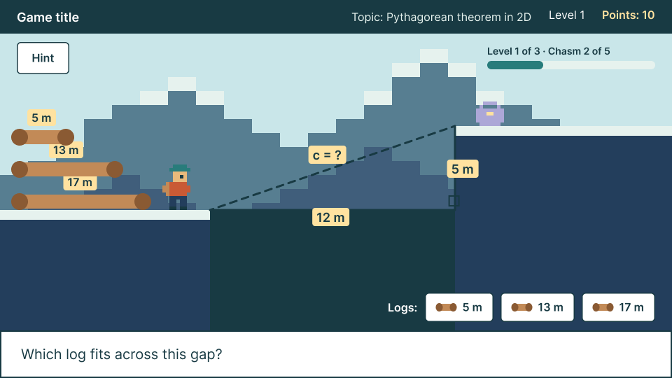

# view/

Draws with Konva and reports clicks through callbacks: the stage, theme, shared components, assets, audio, the Hud and one view per screen.

May import Konva, other `view/` files, and `model/` or `content/` to read what to draw (for example the `Chasm` type). Never imports `controller/` or changes game state.

---

## Table of Contents

- [Overview](#overview)
- [The foundation](#the-foundation)
  - [stage](#stage)
  - [theme](#theme)
  - [fonts and assets](#fonts-and-assets)
- [Shared components](#shared-components)
- [Screens and the Hud](#screens-and-the-hud)
  - [ChasmScreen](#chasmscreen)
  - [Hud](#hud)
- [Still to come](#still-to-come)

---

## Overview

Konva is used only in this folder. A view draws what it's given and reports what the player clicked, and that's all. It never decides whether a log was right or what happens next; a controller does. In other words, a view is told "here is a chasm, draw it", and it answers "log 2 was clicked".

Everything is drawn in a fixed **960 × 540** space, the size of the Figma mockups, so positions can be copied straight from them. The stage then scales the whole canvas to fit the window.

---

## The foundation

### stage

**Purpose**\
Creates the game's one Konva stage, inside the page's `game` element, with three layers listed back to front:
   - `background`: Scenery that rarely changes and ignores clicks. With each layer being its own canvas, changing the others doesn't redraw it.
   - `sprites`: Characters and props.
   - `ui`: Buttons, boxes and the Hud.

**Fitting the window**\
The stage is scaled to the largest 16:9 box that fits the browser window, and rescaled whenever the window changes size. Views keep using 960 × 540 coordinates, and Konva maps clicks back through the scale.

**How it's used**\
`main.ts` calls **`createStage`** once at startup. Views receive its layers instead of making their own, and only this file creates a stage (a test checks that).

### theme

**Purpose**\
Keeps every color from the mockups, and the text styles we use so far, in one place in the code.
   - `colors`: Named after the matching Palette styles in Figma, such as `skyDay`, `ink` and `teal`.
   - `text`: Defines styles such as `title`, `heading`, `dialog`, `body`, `label` and `math`. A view spreads one into a Konva text node instead of writing the font, size, and color by hand. They all default to the ink color, so white text on a button sets its color after the style.

### fonts and assets

**fonts**\
Inter is bundled with the game instead of loaded from Google, so it works offline and on school networks that block font sites. **`loadFonts`** waits for its regular (400) and semi bold (600) weights, so text is drawn in the right font from the first frame.

**assets**\
**`loadAssets`** loads every image and sound listed at the file's top just one time before anything is drawn. Views then get them by name with **`image`** and **`sound`**. To add one, put the file in `public/assets/images/` (or `sounds/`) and add a line to the list.

**Neither one can stop the game**\
`main.ts` waits for both fonts and assets before drawing. If a file fails or takes too long, it's reported in the console and replaced, with a missing image showing as a purple box with a "?", a missing sound playing silence, and a missing font weight falling back to sans-serif.

---

## Shared components

Each matches a component on the Resources page of the mockups, and each is a function that builds a Konva group for a screen to place, along with a way to update it where needed. The clickable ones report clicks through a callback, and leave it to whoever passed in that callback to decide what the click means.

   - **Button**: A rounded button that grows to fit its label, in a `primary` (teal) or `secondary` (outlined) style. It responds both to clicks and to taps, since school Chromebooks often have touchscreens.
   - **Log button**: One of the logs the player picks from, with a log icon and its length. It has three looks, which are `default`, `selected`, and `used` (faded and ignores clicks).
   - **Top bar**: The dark bar across the top of every play screen, with the game title on the left and the topic, level and points on the right.
   - **Dialog box**: The white box along the bottom that shows one line of the story and up to three choices. It resizes to fit its text and stays pinned to the bottom of the stage. A choice reports its position (0 for the first), which is the same number a screen reports to GameFlow.

---

## Screens and the Hud

### ChasmScreen

\
*The "Pick a log" mockup that ChasmScreen follows.*

**Purpose**\
Draws one chasm, which is made up of the sky and mountains, the two cliffs and the gap, the right triangle with its side lengths (such as `12 m`, `5 m` and `c = ?`), the pile of logs, one log button per log, and the question "Which log fits across this gap?" in a dialog box.

**What it's given**\
The stage's layers and a chasm to draw: its two sides and the log lengths, in the order the buttons show them.

**What it reports**\
Each click on a log button reports that log's position in the list. Once its controller **`lock`**s it, it stops reporting clicks and shows the picked log as used. **`destroy`** removes everything it drew.

### Hud

**Purpose**\
Everything the player always sees while playing, including the top bar, a progress line such as "Level 1 of 3 · Chasm 2 of 5", and a "+10 points" tag that floats up and fades after a correct pick.

**How it's used**\
GameFlow calls **`update`** with the latest progress whenever it changes, and **`showPointsGained`** after a pick that earned points. The Hud receives a read-only `ProgressView` (see [model/](../model/README.md#playerprogress)), so it can show progress but never change it.

---

## Still to come

   - **MedalScreen**: The end screen with the medal and results. In review in PR #136.
   - **audio**: Plays one sound per outcome (#25), once the sound library (#102) lands.
   - **DialogueBox, TitleScreen, ShopScreen, ZiplineDiagram**: The views for the dialogue, title and shop screens (#18, #70, #52, #61).
   - **Background images**: The plan in #138 is to load backgrounds as images exported from Figma, instead of drawing mountains in code, so every screen shares one copy of the art.
