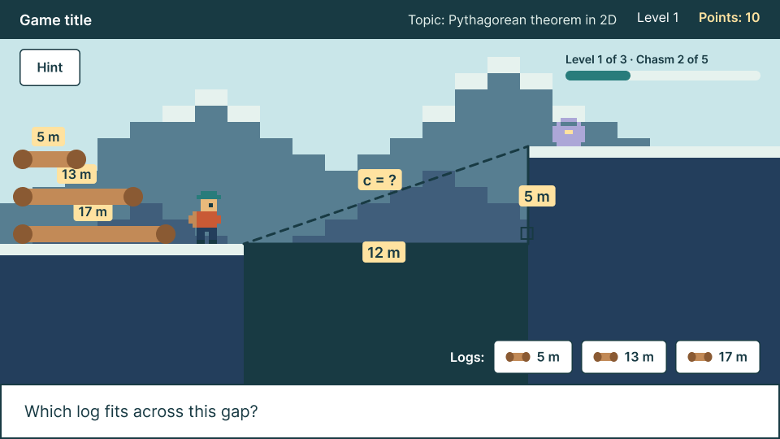

# view/

Draws with Konva and reports clicks through callbacks: the stage, theme, shared components, assets, audio, the Hud and one view per screen.

May import Konva, other `view/` files, and `model/` or `content/` to read what to draw (for example the `Chasm` type). Never imports `controller/` or changes game state.

---

## Table of Contents

- [Overview](#overview)
- [The foundation](#the-foundation)
  - [stage](#stage)
  - [theme](#theme)
  - [fonts and assets](#fonts-and-assets)
  - [loadingScreen](#loadingscreen)
- [Shared components](#shared-components)
- [Screens and the Hud](#screens-and-the-hud)
  - [ChasmScreen](#chasmscreen)
  - [DialogueBox](#dialoguebox)
  - [MedalScreen](#medalscreen)
  - [ShopOfferScreen](#shopofferscreen)
  - [DuelScreen](#duelscreen)
  - [OwnerProgress](#ownerprogress)
  - [TitleScreen](#titlescreen)
  - [Hud](#hud)
- [Still to come](#still-to-come)

---

## Overview

Konva is used only in this folder. A view draws what it's given and reports what the player clicked, and that's all. It never decides whether a log was right or what happens next; a controller does. In other words, a view is told "here is a chasm, draw it", and it answers "log 2 was clicked".

Everything is drawn in a fixed **960 × 540** space, the size of the Figma mockups, so positions can be copied straight from them. The stage then scales the whole canvas to fit the window.

---

## The foundation

### stage

**Purpose**\
Creates the game's one Konva stage, inside the page's `game` element, with three layers listed back to front:
   - `background`: Scenery that rarely changes and ignores clicks. With each layer being its own canvas, changing the others doesn't redraw it.
   - `sprites`: Characters and props.
   - `ui`: Buttons, boxes and the Hud.

**Fitting the window**\
The stage is scaled to the largest 16:9 box that fits the browser window, and rescaled whenever the window changes size. Views keep using 960 × 540 coordinates, and Konva maps clicks back through the scale. The scale itself comes from **`fitScale`**, a small function kept apart from the resizing so its tests can check many window sizes without a browser.

**How it's used**\
`main.ts` calls **`createStage`** once at startup. Views receive its layers instead of making their own, and only this file creates a stage (a test checks that).

### theme

**Purpose**\
Keeps every color from the mockups, and the text styles we use so far, in one place in the code.
   - `colors`: Named after the matching Palette styles in Figma, such as `skyDay`, `ink` and `teal`.
   - `text`: Defines styles such as `title`, `heading`, `dialog`, `body`, `label` and `math`. A view spreads one into a Konva text node instead of writing the font, size, and color by hand. They all default to the ink color, so white text on a button sets its color after the style.

### fonts and assets

**fonts**\
Inter is bundled with the game instead of loaded from Google, so it works offline and on school networks that block font sites. **`loadFonts`** waits for its regular (400) and semi bold (600) weights, so text is drawn in the right font from the first frame.

**assets**\
**`loadAssets`** loads every image and sound listed at the file's top just one time, before the title screen is drawn. It can be given an `onProgress(loaded, total)` callback, which it calls as each file finishes (a file that fails or times out counts as finished), so the loading screen can fill its bar. Views then get them by name with **`image`** and **`sound`**. To add one, put the file in `public/assets/images/` (or `sounds/`) and add a line to the list.

**Neither one can stop the game**\
`main.ts` waits for both fonts and assets before drawing the title, with a loading screen in between if that takes a while. If a file fails or takes too long, it's reported in the console and replaced, with a missing image showing as a purple box with a "?", a missing sound playing silence, and a missing font weight falling back to sans-serif.

### loadingScreen

**Purpose**\
Shows players that the game is working while images and sounds load, instead of a blank page (#129). The images aren't ready yet, so it's built only from theme colors, shapes and text: the title screen's day sky, the game's name, a bar that fills as files finish, and "Loading…".

**How it's used**\
**`showLoadingScreen(layer)`** draws it with an empty bar and returns a `LoadingScreen` with **`progress(loaded, total)`**, which fills the bar, and **`remove()`**. When to show and remove it is decided by `showWhileSlow` in [controller/](../controller/README.md#loading), so a fast load never shows it at all.

---

## Shared components

Each matches a component on the Resources page of the mockups, and each is a function that builds a Konva group for a screen to place, along with a way to update it where needed. The clickable ones report clicks through a callback, and leave it to whoever passed in that callback to decide what the click means.

   - **Button**: A rounded button that grows to fit its label, in a `primary` (teal) or `secondary` (outlined) style. It responds both to clicks and to taps, since school Chromebooks often have touchscreens.
   - **Log button**: One of the logs the player picks from, with a log icon and its length. It has three looks, which are `default`, `selected`, and `used` (faded and ignores clicks).
   - **Top bar**: The dark bar across the top of every play screen, with the game title on the left and the topic, level and points on the right.
   - **Dialog box**: The white box along the bottom that shows one line of the story and up to three choices. It resizes to fit its text and stays pinned to the bottom of the stage. A choice reports its position (0 for the first), which is the same number a screen reports to GameFlow.

---

## Screens and the Hud

### ChasmScreen

\
*The "Pick a log" mockup that ChasmScreen follows.*

**Purpose**\
Draws one chasm, which is made up of the sky and mountains, the two cliffs and the gap, the right triangle with its side lengths (such as `12 m`, `5 m` and `c = ?`), the pile of logs, one log button per log, and the question "Which log fits across this gap?" in a dialog box.

**What it's given**\
The stage's layers and a chasm to draw: its two sides and the log lengths, in the order the buttons show them.

**What it reports**\
Each click on a log button reports that log's position in the list. Once its controller **`lock`**s it, it stops reporting clicks and shows the picked log as used. **`destroy`** removes everything it drew.

**The hint**\
A Hint button sits at the top left, just below the Hud's progress tag, since the mockup's spot is taken by that tag in the game. **`onHintClicked`** reports each click, and ChasmController decides what to do. **`showHint`** shows the formula card (drawn by `createFormulaCard` in `view/formulaCard.ts`, which sizes itself to its text) and puts the hint's line and a Back button in the dialog box, and Back reports as choice 0. **`hideHint`** hides the card and puts the question back. Once a pick's feedback shows, the Hint button and card go away for that chasm. The words come from `content/hintText`.

### DialogueBox

**Purpose**\
Shows one dialogue line at a time in the shared dialog box. A line with no choices gets a Continue button, while a line that ends a scene, like a Level done message, shows its own choices instead.

**What it reports**\
Either way, a click reports the button's position, and the DialogueController decides what it means. **`destroy`** removes the box. The speaker's name isn't drawn yet, since every line so far is the Narrator's.

### MedalScreen

**Purpose**\
Draws the end screen like the "End: medal" mockup, which is made up of the medal the player earned, a sentence about it, the medal requirements, and a See Results button.

**How it's used**\
**`drawMedalScreen`** is given the stage's layers, the medal and points (which MedalController works out), and a callback for See Results. It returns a function that removes everything it drew, to call when the screen ends. For now, it draws its own mountain background; the mockup uses the glacier background instead, which #138's plan to load backgrounds as images would fix.

### ShopOfferScreen

**Purpose**\
Draws the outside of a shop with the player walking up to it, and the shop's offer in the shared Dialog box, like the "Supply shop offer" and "Clothing shop offer" mockups. Each shop's scene is one image exported from Figma (`shopSuppliesOutside` and `shopClothingOutside` in `assets`), following #138's plan.

**How it's used**\
`new ShopOfferScreen(layers, shop, offer)` takes the shop's name and its offer from `content/shopText`. **`draw`** draws the scene and the offer once, **`onChoice`** registers the callback for a button click, and **`destroy`** removes everything. A click reports the button's position, accept first and decline second, and ShopOfferController decides what it means.

### DuelScreen

**Purpose**\
Draws the math duel at the supply shop one page at a time, like the Math duel mockups:
   - **Challenge**: The inside of the shop, with shelves of goods, a window, the store owner behind the counter and the player.
   - **Tutorial offer**: The store owner up close.
   - **Tutorial and solution**: Squared paper, as in "Tutorial (2D)" and "Solution (2D)", with the shared right triangle beside a card of numbered, worked steps. The tutorial uses a general example (12, 16 and 20, with the sides called a, b and c, a triangle the game never asks about so it can't give away an answer), and the solution uses the duel question's own numbers, solving for x as the duel page asks.
   - **The duel**: A white card with "Solve for x.", the question's triangle and its answers, between the player and the store owner. The dialog box is hidden on this page, and the answers are plain buttons, so the first can't look like a hint. The top-left corner is left empty for the store owner's progress, which #57 draws.
   - **Won**: A card with the bag of climbing gear.
   - **Climb**: The player climbing a cliff on a rope, in front of the mountains.
   - **Lost**: The player, the celebrating store owner, and the Explanation card, a gray panel with the right answer.

**How it's used**\
`new DuelScreen(layers, question)` takes the duel question from `model/problems`. **`show(page, text, choices)`** draws a page with its text from `content/duelText` and its buttons, replacing the page before; **`onChoice`** registers the callback for a button click, and **`destroy`** removes everything. A click reports the button's position, and DuelShopController decides what it means.

### OwnerProgress

**Purpose**\
Shows the store owner's race on the duel page (#57): a small white panel in the top-left corner, under the Hud's level tag, with a pie that fills over `settings.ownerSolveMs` beside "Store owner · Solving…" (words from `content/duelText`). The time comes from `Konva.Animation`'s frame time, not the wall clock.

**How it's used**\
`new OwnerProgress(layers.ui)` has the shape of DuelShopController's `OpponentTimer`, so it's passed straight to the controller. **`start(onFinish)`** draws an empty pie and starts filling it, calling `onFinish` once when it's full; **`stop()`** stops the animation and removes the panel, and is safe to call when it isn't running or from inside `onFinish`. Nothing is drawn until `start`, so the panel only appears on the duel page.

### TitleScreen

**Purpose**\
Draws the title screen like its mockup: the mountains, the mountaineer and the friend, and a card with the game's name, a one-line pitch, New game, and Continue when there's a game to continue. The mountains are one image exported from Figma (`mountainsDay` in `assets`), so #138 can reuse it for the chasm screen. The mockup's small note under the buttons is for us, not players, so it isn't drawn.

**How it's used**\
`new TitleScreen(layers)` and then **`draw(canContinue)`** draws it once, **`onChoice`** registers the callback for a button click, and **`destroy`** removes everything. A click reports the button's position, New game first and Continue second, and TitleController decides what it means.

### Hud

**Purpose**\
Everything the player always sees while playing, including the top bar, a progress line such as "Level 1 of 3 · Chasm 2 of 5", and a "+10 points" tag that floats up and fades after a correct pick.

**How it's used**\
GameFlow calls **`update`** with the latest progress whenever it changes, and **`showPointsGained`** after a pick that earned points. The Hud receives a read-only `ProgressView` (see [model/](../model/README.md#playerprogress)), so it can show progress but never change it.

---

## Still to come

   - **The solution view** (#48): The "How to find the right log" screen, with the triangle and the worked steps.
   - **audio**: Plays one sound per outcome (#25), once the sound library (#102) lands.
   - **ZiplineDiagram**: The view for the zipline problem (#61).
   - **Background images**: The plan in #138 is to load backgrounds as images exported from Figma, instead of drawing mountains in code, so every screen shares one copy of the art.
